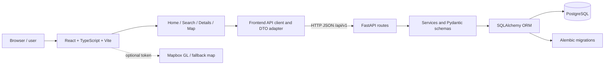
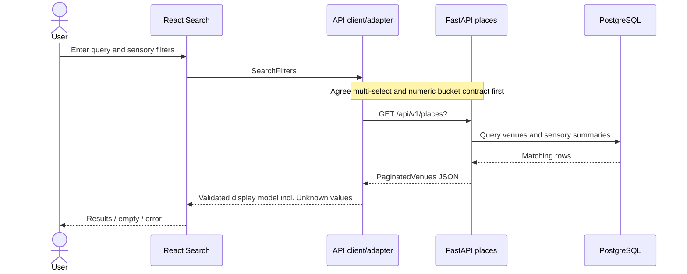

# Sensory Scout — Sprint 1 System Architecture (Design & Architecture)
Prepared by Hamza Shakur, Team 4 | 2026-10-20 | Review-ready design, not proof of completed integration

## 1. Purpose and scope
Help users with sensory sensitivities explore venues by noise, lighting, crowds and location. Sprint 1 focuses on browsing/searching, place details and the architectural foundation. Reviews, saved places and personalization remain future-facing unless proven implemented.

## 2. Component architecture

The adapter is a **proposed integration boundary**, not a claim that it exists. On reviewed main, the frontend API client still uses mock data and the backend implements details but not listing/search.

## 3. Data model
Backend's existing seven-table model: `users`, `sensory_profiles`, `venues`, `reviews`, `ratings`, `review_votes`, `saved_places`. Venue details expose identity, category, address, city, optional coordinates/image, review count, sensory rating means/counts and accessibility report counts. Sensory scores are 1–5, nullable if not reported; they are not overall quality stars.

## 4. API interfaces
**Implemented on reviewed main:** `GET /api/v1/places/{place_id}` with positive integer ID; `200 VenueDetail`, `404` unknown, `422` invalid. **Proposed but not yet implemented on main:** `GET /api/v1/places` with pagination and filters, returning `PaginatedVenues`. The authoritative field-level reference is `backend/API_CONTRACT.md`; avoid creating conflicting definitions.

## 5. Search sequence (target)

This sequence is the **target behavior**; the live listing endpoint and adapter were not on reviewed main.

## 6. Data compatibility and accessibility rules
- IDs: backend integers, frontend mock string slugs; use numeric API IDs, never send a slug to the integer details route.
- Sensory: 1–5 numeric averages to category labels needs a documented team-approved mapping; unknown stays Unknown.
- Multi-select: frontend OR-within-filter and AND-across-filters must match backend semantics. Numeric max/min query params do not represent all combinations.
- Accessibility: report counts indicate user reports, **not verified wheelchair accessibility**; no sensory-room field exists in backend details.
- Coordinates: latitude/longitude may be null. Skip marker and offer safe address fallback; do not invent coordinates.
- Missing fields: overall star rating, individual review text, hours and photo gallery are not in current details contract. Hide, label unavailable, or explicitly use demo-only data.
- Security: use environment variables for API URLs and map tokens, never commit secrets; validate query input on backend; CORS configured for trusted frontend origins.
- Quality: keyboard access, text labels, empty/loading/error states and responsive layouts must be tested, not assumed.

## 7. Design decision register
| Decision | Options | Proposed resolution | State |
|---|---|---|---|
| Numeric-to-label sensory buckets | discrete buckets / server categories | Agree thresholds with Robert, Soma, Yasser and frontend owners | OPEN |
| Multiple selections | category arrays / post-filtering | Backend should support documented OR-within-group, AND-across-groups, with pagination computed after filtering | OPEN |
| Missing data | unknown / omitted | Show Unknown, never fabricate values | PROPOSED |
| Accessibility | reported counts / Boolean | Display reports with caveat; don't assert verified access | PROPOSED |
| Reviews and overall stars | add endpoints / hide live UI | Defer or label prototype until backend supplies them | OPEN |
| Map null coords | hide marker / address geocoding | Hide marker; address fallback for directions | PROPOSED |

## 8. Traceability and change control
Requirement themes: browse/search -> list endpoint and Search UI; sensory preference -> filter contract; place details -> details endpoint; map -> nullable-coordinate handling; accessibility -> evidence-based display. Execution scenarios are tracked in `SPRINT1_INTEGRATION_TEST_MATRIX.md`. Changes to public API, schema or shared components require teammate review; merge through PRs, never directly to main.

## 9. Acceptance and outstanding dependencies
Integration is complete only when frontend performs live HTTP calls to FastAPI/PostgreSQL for browse/search/details, agreed filters and null behavior are verified, automated tests pass on the merged commit, and demo evidence is captured. Current blockers: backend list/filter route, frontend adapter and shared contract decisions. This document is an architecture artifact and does not certify those features as complete.
